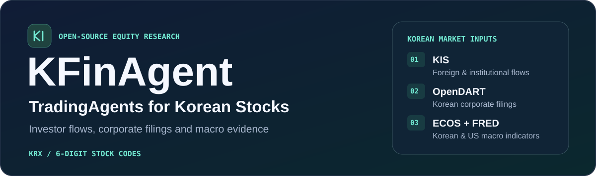
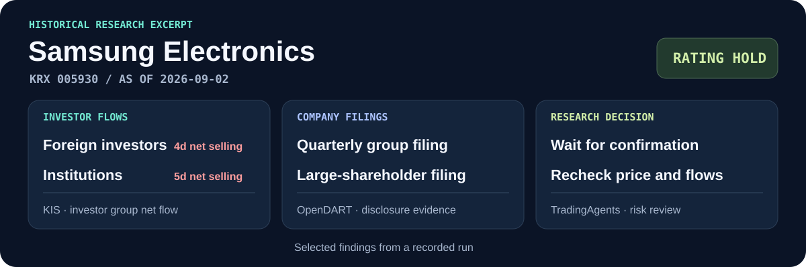
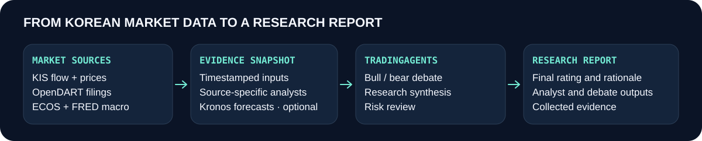

<p align="center">
  
</p>

<p align="center">
  <a href="README.md">한국어</a> ·
  <a href="#samsung-electronics-example">Example report</a> ·
  <a href="#quickstart">Quickstart</a> ·
  <a href="#how-it-works">Workflow</a> ·
  <a href="https://github.com/SeungMin2001/KFinAgent/releases">Releases</a>
</p>

# KFinAgent

**Multi-agent research for Korean stocks, built on TradingAgents.** Enter a six-digit KRX code to collect **foreign and institutional investor flows** from Korea Investment & Securities and **Korean corporate filings** from OpenDART. Analysts organize the evidence before a bull/bear debate and risk review produce a research report. The workflow does not place orders.

| Data source | What the agents examine |
| --- | --- |
| KIS | Daily bars, technical indicators and net flow by investor group |
| OpenDART | Corporate filings and financial evidence from periodic reports |
| Bank of Korea ECOS · FRED | Korean rates and inflation alongside US macro indicators |
| Kronos · optional | Forecast paths and uncertainty from KIS daily candles |

## Samsung Electronics example

<p align="center">
  <a href="docs/examples/samsung-005930.md"></a>
</p>

[**Read the Samsung Electronics report excerpt →**](docs/examples/samsung-005930.md) · Historical example as of September 2, 2026, based on a recorded run.

## Quickstart

Use Python 3.12. Request your own data provider and LLM credentials and store them in a local `.env` file.

```bash
git clone https://github.com/SeungMin2001/KFinAgent.git
cd KFinAgent
python3.12 -m venv .venv
source .venv/bin/activate
python -m pip install -r requirements.lock
python -m pip install -e .
cp .env.example .env
```

| Request access | Environment variables | Used for |
| --- | --- | --- |
| [KIS Developers](https://apiportal.koreainvestment.com/) | `KIS_APP_KEY`, `KIS_APP_SECRET`, `KIS_ENV` | Basic research. Use a key with domestic quote access and select the matching `real` or `demo` environment |
| [OpenAI](https://platform.openai.com/api-keys) | `OPENAI_API_KEY` | Default LLM provider. See [.env.example](.env.example) for other providers |
| [OpenDART](https://opendart.fss.or.kr/) | `DART_API_KEY` | Filings in enhanced mode |
| [Bank of Korea ECOS](https://ecos.bok.or.kr/api/) | `ECOS_API_KEY` | Korean macro evidence in enhanced mode |
| [FRED](https://fred.stlouisfed.org/docs/api/api_key.html) | `FRED_API_KEY` | US macro evidence in enhanced mode |

```bash
# Basic research with KIS prices and your LLM
python scripts/korean_stock_research.py 005930 --account-mode disabled --kronos-mode disabled

# Korean market research with filings, investor flows and macro evidence
python scripts/korean_stock_research.py 005930 --enhanced --account-mode disabled --kronos-mode disabled
```

The CLI prints the report path. Open `FINAL_BRIEF.md` for the decision summary, `0_evidence.md` for the collected evidence and `complete_report.md` for the analyst outputs and debate. Use `--date YYYY-MM-DD` for a historical analysis date and `--verbose` to see stage outputs during the run. Set `--model` or the `TRADINGAGENTS_*` model variables for models available to your account.

<details>
<summary>Add Kronos forecasts</summary>

Set `KRONOS_API_URL` and `KRONOS_API_KEY` for your deployed Kronos endpoint and change the enhanced command to `--kronos-mode remote`. [Deployment guide](docs/KRONOS_RUNPOD.md)

</details>

## How it works

<p align="center">
  
</p>

Source-specific analysts interpret their assigned evidence. TradingAgents' bull/bear debate and risk review combine observations, uncertainties and conflicting signals before issuing a research rating.

## Evaluation and contributing

- [Exploratory pilot](docs/BENCHMARK_RESULTS.md) · [Regime comparisons](docs/BENCHMARK_REGIMES.md). These historical case studies do not establish outperformance or a general incremental effect from Kronos.
- To run tests without provider credentials, install `python -m pip install -e '.[dev]'` and run `python -m pytest -q`.
- Share your run mode, environment and error message when opening an [issue](https://github.com/SeungMin2001/KFinAgent/issues). Remove API keys and account information from logs.

## Credits and license

KFinAgent adapts the multi-agent workflow from [TradingAgents](https://github.com/TauricResearch/TradingAgents) to Korean market data and integrates [Kronos](https://github.com/shiyu-coder/Kronos) for optional time-series evidence. [Apache 2.0](LICENSE) · [Upstream attribution](NOTICE)
