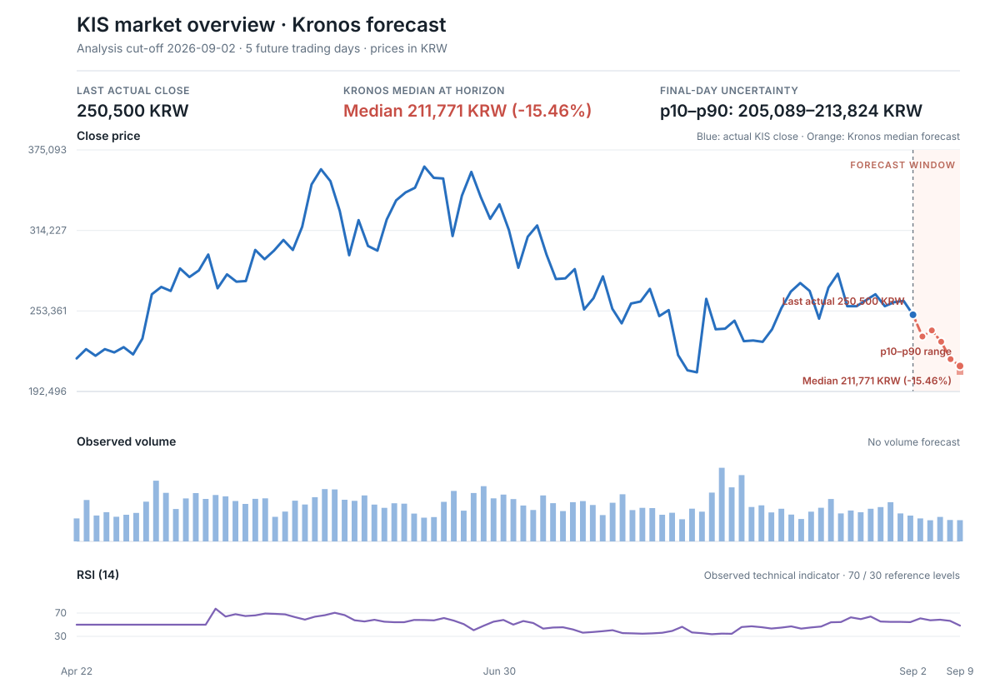

# KStockAgents

**TradingAgents for Korean Stocks**

Enter a six-digit KRX ticker to collect **foreign and institutional investor flows, OpenDART filings, and Bank of Korea data**. Bull and bear researchers debate the evidence, risk analysts challenge the proposal, and the portfolio manager records a rating and conditions to watch in a Korean-language report.

<a href="README.md"><kbd>한국어</kbd></a> <a href="README.en.md"><kbd>English</kbd></a>

## Architecture and debate


1. **Collect evidence.** The CLI verifies KIS candles first. Enhanced mode builds a snapshot from filings, investor flows and macro data with sources and analysis dates.
2. **Debate the thesis.** The Bull and Bear researchers compare the analyst reports and challenge each other's cases. The research manager summarizes their arguments and conditions to watch.
3. **Review the proposal.** The trader drafts a proposal. Aggressive, conservative and neutral risk analysts debate its assumptions, and the portfolio manager records the final opinion. The workflow does not place orders.

## Output from a recorded run



This SVG was generated by a Samsung Electronics `005930` run with an analysis date of **2026-09-02**. Blue shows the KIS observed close. Orange shows the five-day Kronos median path and the sampled p10–p90 range on the last forecast day. The agent weighed the longer-term trend against foreign and institutional net selling and returned **Hold**. The evidence and decision excerpt is in `docs/examples/samsung-005930.md`.

## Quickstart

### 1. Install

Use Python 3.12. The commands below are for macOS and Linux.

```bash
git clone https://github.com/SeungMin2001/KStockAgents.git
cd KStockAgents
python3.12 -m venv .venv
source .venv/bin/activate
python -m pip install -r requirements.lock
python -m pip install -e .
cp .env.example .env
```

<details>
<summary>Windows PowerShell installation</summary>

```powershell
git clone https://github.com/SeungMin2001/KStockAgents.git
cd KStockAgents
py -3.12 -m venv .venv
.\.venv\Scripts\python.exe -m pip install -r requirements.lock
.\.venv\Scripts\python.exe -m pip install -e .
Copy-Item .env.example .env
```

Use `.\.venv\Scripts\python.exe` in place of `python` in the run examples below.

</details>

### 2. Get your own API keys

Store your credentials in your local `.env`. Basic research needs KIS and an LLM provider. Set up the other keys to include filings, investor flows and macro data in enhanced mode.

| Provider | Environment variables | Mode |
| --- | --- | --- |
| KIS Developers (`https://apiportal.koreainvestment.com/`) | `KIS_APP_KEY`, `KIS_APP_SECRET`, `KIS_ENV` | Basic and enhanced. Use a key with Korean stock quote access and the matching `real` or `demo` environment |
| OpenAI API (`https://platform.openai.com/api-keys`) | `OPENAI_API_KEY` | Basic and enhanced. OpenAI is the default. See `.env.example` for other providers and model settings |
| OpenDART (`https://opendart.fss.or.kr/`) | `DART_API_KEY` | Enhanced · filings and financial evidence |
| Bank of Korea ECOS (`https://ecos.bok.or.kr/api/`) | `ECOS_API_KEY` | Enhanced · Korean macro data |
| FRED (`https://fred.stlouisfed.org/docs/api/api_key.html`) | `FRED_API_KEY` | Enhanced · U.S. macro data |

### 3. Run Samsung Electronics research

```bash
# First run with KIS prices, technical indicators and an LLM
python scripts/korean_stock_research.py 005930 --account-mode disabled --kronos-mode disabled

# Include filings, investor flows and macro data, and show each debate stage
python scripts/korean_stock_research.py 005930 --enhanced --account-mode disabled --kronos-mode disabled --verbose
```

Reports are written under `artifacts/reports/`.

| Output | Contents |
| --- | --- |
| `0_evidence.md` | Collected inputs, source names and as-of dates |
| `complete_report.md` | Analyst reports, bull/bear debate, trader proposal and risk debate |
| `FINAL_BRIEF.md` | Final opinion and key evidence |
| `visuals/market_overview.svg` | Observed prices and optional Kronos forecast |

Use `--date YYYY-MM-DD` for dated research. The commands above disable balance lookup, so account configuration can be left blank. If authentication or required evidence collection fails, the CLI reports the problem before running the agents. If your account lacks model access, set `--model` to a model available to you.

## What changes for Korean stocks

The Korean CLI inherits the market, sentiment, news and fundamentals roles from upstream TradingAgents. The upstream diagram shows Yahoo Finance and social and news feeds. The Korean CLI connects those roles to **KIS prices and investor flows and OpenDART filings**, and adds ECOS for Korean rates and inflation.

| TradingAgents role | KStockAgents evidence |
| --- | --- |
| **Market** | Verified KIS daily bars and volumes with computed indicators including moving averages, RSI, MACD and ATR |
| **Sentiment** | KIS net flows for foreign investors, institutions, investment trusts and funds, including 5- and 20-session totals and buying or selling streaks |
| **News** | Recent OpenDART filings mapped from the KRX ticker and relevant KIS market headlines |
| **Fundamentals** | Financial evidence from OpenDART periodic filings, including gaps in the available figures |
| **Macro** | Bank of Korea ECOS rates and inflation, alongside U.S. rates, dollar and volatility measures from FRED |
| **Time-Series Forecast** · optional | Kronos paths and uncertainty from the same verified KIS candles |

For example, the Korean sentiment analyst bases its report on **investor-group net flows**. Each source keeps its date and scope so the debate can examine disagreements between filings, flows and price action.

## Add Kronos forecasts

A separately deployed Kronos service forecasts from **verified KIS OHLCVA daily bars**. The filings, flow and macro data go to their LLM analysts. The default forecast configuration uses **40 observed bars, a 12-bar horizon, and 10 sampled paths**. The forecast analyst summarizes the median and sample dispersion for the researchers to weigh alongside the other evidence.

1. Deploy the service using the Kronos deployment guide (`docs/KRONOS_RUNPOD.md`).
2. Set `KRONOS_API_URL=https://<host>/v1/forecast` and `KRONOS_API_KEY` in your local `.env`.
3. Run enhanced research with the remote forecast. Results depend on the configured endpoint being available.

```bash
python scripts/korean_stock_research.py 005930 --enhanced --account-mode disabled --kronos-mode remote
```

Forecast dates currently use weekdays and can differ from the KRX holiday calendar. See the exploratory pilot (`docs/BENCHMARK_RESULTS.md`) and regime case studies (`docs/BENCHMARK_REGIMES.md`). They do not establish outperformance or a general incremental benefit from Kronos.

## Credits and license

The diagram follows the team and debate structure in the upstream TradingAgents diagram (`https://github.com/TauricResearch/TradingAgents/blob/main/assets/schema.png`) and illustrates the Korean CLI flow. Apache 2.0 (`LICENSE`) · Upstream attribution (`NOTICE`)
