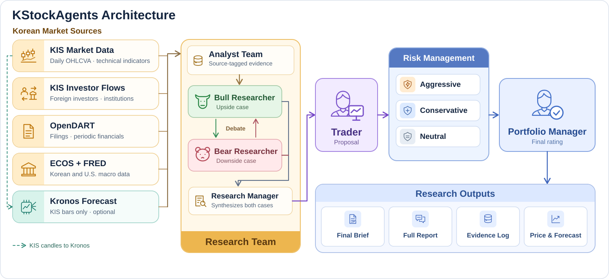

# KStockAgents

**TradingAgents 기반 한국 주식 리서치 에이전트**

삼성전자 `005930` 같은 6자리 종목코드를 입력하면 **외국인·기관 수급, OpenDART 공시, 한국은행 경제지표**를 모읍니다. 상승·하락 리서처와 리스크 분석가가 같은 근거를 두고 토론하고, 최종 의견과 확인할 조건을 한국어 보고서에 남깁니다.

[English](README.en.md) · [실행 결과](#실제-실행-결과) · [빠른 시작](#빠른-시작) · [한국 시장에 맞춘 부분](#한국-시장에-맞춘-부분) · [아키텍처와 토론](#아키텍처와-토론) · [Kronos](#kronos로-시계열-근거-추가)

## 실제 실행 결과


삼성전자 `005930`, **2026-09-02 기준** 실행에서 생성된 SVG입니다. 파란색은 KIS 관측 종가, 주황색은 5일 Kronos 중앙 예측 경로, 세로 막대는 마지막 예측일의 표본 p10–p90 범위입니다. 이 실행에서 에이전트는 장기 추세와 외국인·기관 동반 순매도를 함께 검토해 **Hold** 의견을 냈습니다. [공시·수급·판단 근거 발췌](docs/examples/samsung-005930.md)

## 빠른 시작

### 1. 설치

Python 3.12 기준입니다. 아래는 macOS/Linux 명령입니다.

```bash
git clone https://github.com/SeungMin2001/KStockAgents.git
cd KStockAgents
python3.12 -m venv .venv
source .venv/bin/activate
python -m pip install -r requirements.lock
python -m pip install -e .
cp .env.example .env
```

<details>
<summary>Windows PowerShell 설치 명령</summary>

```powershell
git clone https://github.com/SeungMin2001/KStockAgents.git
cd KStockAgents
py -3.12 -m venv .venv
.\.venv\Scripts\python.exe -m pip install -r requirements.lock
.\.venv\Scripts\python.exe -m pip install -e .
Copy-Item .env.example .env
```

이후 실행 예시의 `python`은 `.\.venv\Scripts\python.exe`로 바꿔 실행하세요.

</details>

### 2. 본인 API 키 발급

발급받은 값을 로컬 `.env`에 입력하세요. 기본 실행에 필요한 키는 KIS와 LLM 두 종류입니다. 수급·공시·거시 지표를 포함하려면 확장 실행에 필요한 키도 추가하세요.

| 발급처 | 환경변수 | 필요한 모드 |
| --- | --- | --- |
| [한국투자증권 Open API](https://apiportal.koreainvestment.com/) | `KIS_APP_KEY`, `KIS_APP_SECRET`, `KIS_ENV` | 기본·확장. 국내 시세 조회 권한이 있는 키를 쓰고 종류에 맞게 `real` 또는 `demo` 지정 |
| [OpenAI API](https://platform.openai.com/api-keys) | `OPENAI_API_KEY` | 기본·확장. 기본 LLM 제공처이며, 다른 제공처와 모델은 [설정 예시](.env.example) 참고 |
| [금융감독원 OpenDART](https://opendart.fss.or.kr/) | `DART_API_KEY` | 확장 · 공시·재무 |
| [한국은행 ECOS](https://ecos.bok.or.kr/api/) | `ECOS_API_KEY` | 확장 · 국내 거시 지표 |
| [FRED](https://fred.stlouisfed.org/docs/api/api_key.html) | `FRED_API_KEY` | 확장 · 미국 거시 지표 |

### 3. 삼성전자 분석

```bash
# KIS 시세·기술지표와 LLM으로 첫 실행
python scripts/korean_stock_research.py 005930 --account-mode disabled --kronos-mode disabled

# 공시·수급·거시 지표까지 분석하고 토론 단계 출력
python scripts/korean_stock_research.py 005930 --enhanced --account-mode disabled --kronos-mode disabled --verbose
```

실행이 끝나면 `artifacts/reports/` 아래에 결과가 저장됩니다.

| 결과 | 확인할 내용 |
| --- | --- |
| `0_evidence.md` | 분석 전에 수집한 데이터와 기준일, 출처 |
| `complete_report.md` | 분석가 보고서, 상승·하락 논쟁, 트레이더 제안, 리스크 토론 |
| `FINAL_BRIEF.md` | 최종 의견과 핵심 근거 |
| `visuals/market_overview.svg` | 관측 가격 차트와 선택적으로 표시되는 Kronos 예측 |

과거 날짜는 `--date YYYY-MM-DD`로 지정하세요. 공개 가이드는 `--account-mode disabled`를 사용하므로 잔고 조회에 필요한 계좌 설정은 생략할 수 있습니다. 데이터 제공처 인증이나 필수 데이터 조회에 실패하면 에이전트 실행 전에 오류가 표시됩니다. 모델 접근 오류가 나면 계정에서 쓸 수 있는 모델을 `--model`로 지정하세요.

## 한국 시장에 맞춘 부분

원본 [TradingAgents](https://github.com/TauricResearch/TradingAgents)의 시장·심리·뉴스·펀더멘털 역할과 토론 구조를 이어받았습니다. 원본 도식이 Yahoo Finance 시장 데이터와 소셜·뉴스를 예로 드는 자리에는 **KIS 시세·투자자 수급과 OpenDART 공시**를 연결합니다. 미국 거시 지표에 한국은행 ECOS를 더해 한국 금리와 물가를 함께 읽습니다.

| TradingAgents 역할 | KStockAgents가 수집하고 해석하는 한국 시장 근거 |
| --- | --- |
| **Market** | KIS 일봉·거래량을 검증한 뒤 이동평균·RSI·MACD·ATR 등 기술지표를 계산 |
| **Sentiment** | KIS의 외국인·기관계·투자신탁·기금별 수급을 기준일에 맞춰 수집. 최근 5일·20일 누적 순매수와 연속 매수·매도 기간을 해석 |
| **News** | 종목코드를 DART 고유번호에 매핑해 최근 공시를 읽고, KIS 종목 관련 시황·공시 헤드라인을 함께 검토 |
| **Fundamentals** | OpenDART 정기보고서에서 확인할 수 있는 재무 근거를 검토. 기준일과 근거가 부족한 항목을 기록 |
| **Macro** | ECOS의 한국 금리·물가와 FRED의 미국 금리·달러·변동성 등으로 거시 환경을 해석 |
| **Time-Series Forecast** · 선택 | 검증된 KIS 일봉에 대한 Kronos 예측과 불확실성을 별도 근거로 정리 |

공시와 수급, 가격이 다른 방향을 가리키면 각각의 출처와 관측 기간을 남겨 토론에서 비교할 수 있게 합니다.

## 아키텍처와 토론



1. **근거 수집** · KIS 일봉을 먼저 검증합니다. 확장 모드에서는 공시·수급·거시 지표를 모아 출처와 기준일이 붙은 스냅샷을 만듭니다.
2. **상승·하락 토론** · 분석가별 보고서가 Bull·Bear 리서처에게 전달됩니다. 양쪽이 가격·수급·공시의 충돌을 검토하고, Research Manager가 논거와 확인 조건을 정리합니다.
3. **제안과 리스크 검토** · Trader가 제안을 작성합니다. 공격적·보수적·중립적 분석가가 가정과 리스크를 검토하고, Portfolio Manager가 최종 의견을 기록합니다. 이 흐름은 주문을 실행하지 않습니다.

## Kronos로 시계열 근거 추가

별도로 띄운 [Kronos](https://github.com/shiyu-coder/Kronos) 서비스에 **검증된 KIS 일봉 OHLCVA**를 보냅니다. 공시·수급·거시 지표는 LLM 분석가가 읽습니다. Kronos의 기본 설정은 **과거 40개 일봉 → 미래 12개 일봉, 10개 표본 경로**입니다. 시계열 분석가는 중앙 예측과 표본 분포를 해석하고, 리서처와 리스크 팀은 이 결과를 다른 근거와 함께 검토합니다.

1. [Kronos 서버 배포 가이드](docs/KRONOS_RUNPOD.md)에 따라 서버를 띄웁니다.
2. 로컬 `.env`에 `KRONOS_API_URL=https://<호스트>/v1/forecast`와 `KRONOS_API_KEY`를 입력합니다.
3. 아래처럼 확장 분석을 실행합니다. 예측 수집에 실패하면 오류가 표시됩니다.

```bash
python scripts/korean_stock_research.py 005930 --enhanced --account-mode disabled --kronos-mode remote
```

현재 미래 날짜는 요일 기준 영업일로 생성되므로 KRX 휴장일과 어긋날 수 있습니다. 성과 검토는 [초기 파일럿](docs/BENCHMARK_RESULTS.md)과 [구간별 사례 분석](docs/BENCHMARK_REGIMES.md)을 참고하세요. 과거 사례 결과만으로 수익 우위나 Kronos의 추가 효과를 일반화할 수 없습니다.

## 출처와 라이선스

팀 구분과 토론 흐름을 그린 아키텍처는 [TradingAgents의 원본 도식](https://github.com/TauricResearch/TradingAgents/blob/main/assets/schema.png)을 참고해 한국 시장 구현에 맞게 제작했습니다. [Apache 2.0](LICENSE) · [원본 저작권 고지](NOTICE) · [이슈](https://github.com/SeungMin2001/KStockAgents/issues)
