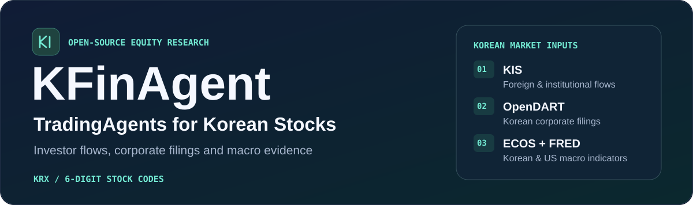
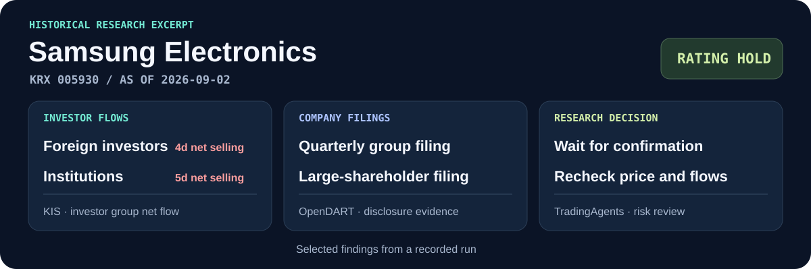
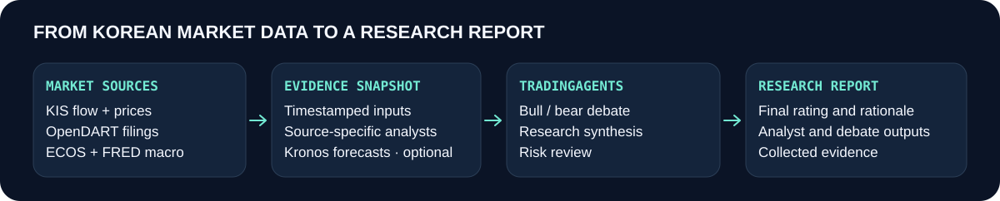

<p align="center">
  
</p>

<p align="center">
  <a href="README.en.md">English</a> ·
  <a href="#삼성전자-분석-예시">분석 예시</a> ·
  <a href="#빠른-시작">빠른 시작</a> ·
  <a href="#작동-방식">작동 방식</a> ·
  <a href="https://github.com/SeungMin2001/KFinAgent/releases">릴리스</a>
</p>

# KFinAgent

**TradingAgents 기반 한국 주식 멀티에이전트 리서치.** 종목코드 하나로 한국투자증권의 **외국인·기관 수급**과 금융감독원의 **OpenDART 공시**를 모읍니다. 분석 에이전트가 근거를 정리하고, 상승·하락 논거와 리스크 토론을 거쳐 최종 의견과 보고서를 작성합니다. 주문 실행 없이 리서치에 사용합니다.

| 한국 시장 데이터 | 에이전트가 확인하는 항목 |
| --- | --- |
| 한국투자증권 KIS | 일봉·거래량·기술 지표, 외국인·기관계·투신·기금 순매수 |
| OpenDART | 국내 기업 공시 원문, 정기보고서에서 확인할 수 있는 재무 근거 |
| 한국은행 ECOS · FRED | 국내 금리·물가와 미국 금리·달러·변동성 등 거시 지표 |
| Kronos · 선택 | KIS 일봉을 입력으로 생성한 예측 경로와 불확실성 |

## 삼성전자 분석 예시

<p align="center">
  <a href="docs/examples/samsung-005930.md"></a>
</p>

[**삼성전자 보고서 발췌 보기 →**](docs/examples/samsung-005930.md) · 분석 기준일 2026-09-02. 저장된 실행 결과에서 공개용으로 정리한 예시입니다.

## 빠른 시작

Python 3.12를 권장합니다. 데이터 제공처와 LLM 서비스에서 본인 키를 발급받아 로컬 `.env`에 입력하세요.

```bash
git clone https://github.com/SeungMin2001/KFinAgent.git
cd KFinAgent
python3.12 -m venv .venv
source .venv/bin/activate
python -m pip install -r requirements.lock
python -m pip install -e .
cp .env.example .env
```

| 발급처 | 환경변수 | 사용 범위 |
| --- | --- | --- |
| [한국투자증권 Open API](https://apiportal.koreainvestment.com/) | `KIS_APP_KEY`, `KIS_APP_SECRET`, `KIS_ENV` | 기본 분석. 국내 시세 조회 권한이 있는 앱 키를 쓰고 키에 맞춰 `real` 또는 `demo` 선택 |
| [OpenAI](https://platform.openai.com/api-keys) | `OPENAI_API_KEY` | 기본 LLM 설정 예시. 다른 제공처는 [환경변수 예시](.env.example) 참고 |
| [OpenDART](https://opendart.fss.or.kr/) | `DART_API_KEY` | 확장 분석의 공시 근거 |
| [한국은행 ECOS](https://ecos.bok.or.kr/api/) | `ECOS_API_KEY` | 확장 분석의 국내 거시 지표 |
| [FRED](https://fred.stlouisfed.org/docs/api/api_key.html) | `FRED_API_KEY` | 확장 분석의 미국 거시 지표 |

```bash
# 기본 분석 · KIS 시세와 LLM
python scripts/korean_stock_research.py 005930 --account-mode disabled --kronos-mode disabled

# 한국 시장 확장 분석 · 공시, 수급, 거시 지표
python scripts/korean_stock_research.py 005930 --enhanced --account-mode disabled --kronos-mode disabled
```

실행이 끝나면 터미널에 보고서 경로가 표시됩니다. `FINAL_BRIEF.md`에서 최종 요약을, `0_evidence.md`에서 분석 입력을, `complete_report.md`에서 분석가별 결과와 토론을 확인할 수 있습니다. 분석일을 지정하려면 `--date YYYY-MM-DD`, 진행 중 분석가 출력을 보려면 `--verbose`를 추가하세요. 모델 접근 권한에 맞춰 `--model` 또는 `TRADINGAGENTS_*` 모델 설정을 지정할 수 있습니다.

<details>
<summary>Kronos 예측을 추가하려면</summary>

별도로 배포한 Kronos 서버의 예측 URL과 키를 `KRONOS_API_URL`, `KRONOS_API_KEY`에 설정한 뒤 확장 분석 명령에 `--kronos-mode remote`를 사용합니다. [배포 가이드](docs/KRONOS_RUNPOD.md)

</details>

## 작동 방식

<p align="center">
  
</p>

공시·수급·거시·시계열 에이전트는 배정된 근거를 해석합니다. TradingAgents의 상승·하락 토론과 리스크 검토 단계는 관측값, 불확실성, 상충하는 근거를 종합해 최종 의견을 만듭니다.

## 평가와 기여

- [초기 평가](docs/BENCHMARK_RESULTS.md) · [기간별 비교](docs/BENCHMARK_REGIMES.md). 과거 구간의 탐색적 사례이며, 수익 우위나 Kronos의 추가 효과를 일반화할 수 없습니다.
- 키 없이 코드 검증을 실행하려면 `python -m pip install -e '.[dev]'` 후 `python -m pytest -q`를 실행하세요.
- 설치나 데이터 연동에 문제가 있으면 실행 모드, 환경, 오류 메시지를 [이슈](https://github.com/SeungMin2001/KFinAgent/issues)에 남겨주세요. 공유할 로그에서는 API 키와 계좌 정보를 빼주세요.

## 출처와 라이선스

[TradingAgents](https://github.com/TauricResearch/TradingAgents)의 멀티에이전트 구조를 한국 시장에 적용한 프로젝트입니다. 시계열 연동은 [Kronos](https://github.com/shiyu-coder/Kronos)를 사용합니다. [Apache 2.0](LICENSE) · [원본 저작권 고지](NOTICE)
